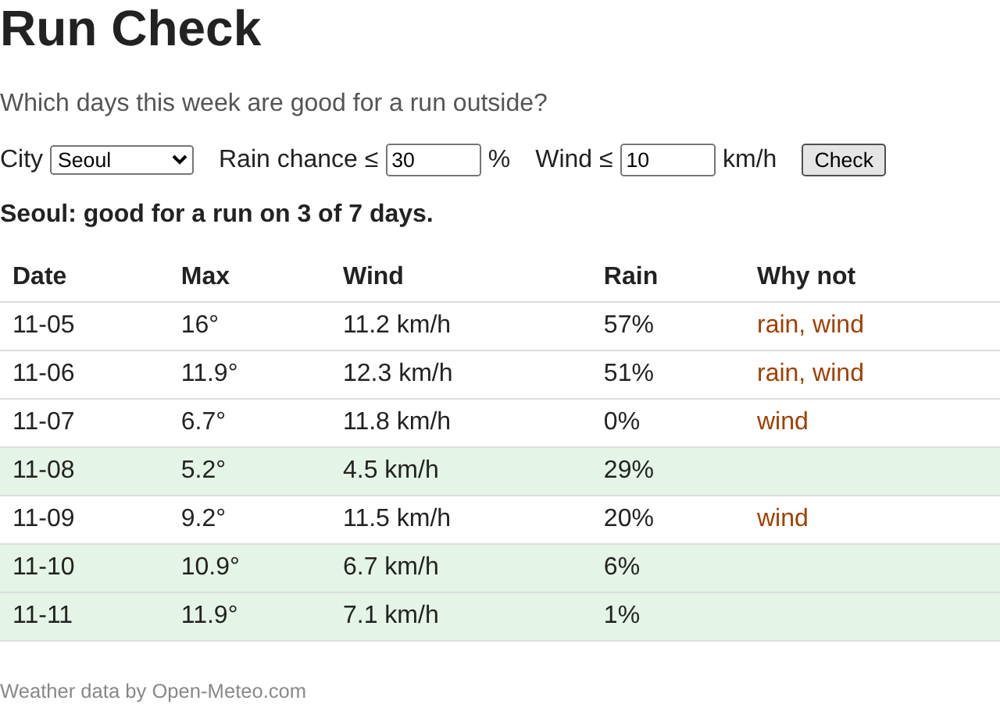

# 9주차 실습 — Front-end Web App

녹강에서는 비 올 확률로 우산이 필요한 날을 칠하는 **Umbrella Check** 를 만들었습니다. 오늘은 같은 방법으로 다른 앱을 혼자 만듭니다.

**Run Check**: 도시를 고르고 기준(강수확률, 풍속)을 정하면, 앞으로 7일 중 밖에서 달리기 좋은 날을 초록색으로 칠하고, 탈락한 날은 왜 탈락했는지 보여 줍니다.

녹강과 다른 점은 세 가지입니다.

- 받아 오는 항목이 다릅니다. 필드 이름은 Open-Meteo 문서에서 직접 찾습니다.
- 규칙의 조건이 두 개입니다(강수확률 **그리고** 풍속). 기준 입력칸도 두 개입니다.
- 문제마다 무엇을 만들지와 확인 방법은 정확히 적혀 있지만, 코드는 적혀 있지 않습니다. 단계마다 붙은 **참고** 줄이 녹강의 어느 장을 보면 되는지, 슬라이드와 무엇이 다른지 알려 줍니다.

막히면 맨 아래 **부록: 흔한 오류**를 먼저 보고, 그래도 안 되면 손을 드세요.

## 규칙

- **저장소**: 이 저장소를 템플릿으로 내 계정에 `oss-week09` 를 만듭니다(정확히 이 이름, Public). 문제마다 지정된 **커밋 메시지**를 그대로 씁니다.
- **확인 방법**: 저장소의 파일과 커밋을 봅니다. 따로 제출하는 파일은 없습니다.
- 저장소 어디에도 **이름·학번을 적지 않습니다.**
- 페이지는 파일을 더블클릭해서 열지 않고 **`npx serve .` 로 띄운 주소(http://localhost:3000)** 로 엽니다. 더블클릭(`file://`)으로 열면 모듈 스크립트가 막혀 아무것도 동작하지 않습니다.
- 코드를 고친 뒤에는 **저장하고 브라우저에서 F5**. 문제의 "확인"을 눈으로 본 뒤에 커밋합니다.
- 문제지의 브라우저 메시지와 개발자 도구 메뉴 이름은 영어 Chrome 기준입니다. 한국어 Chrome 이면 번역되어 보입니다(`No throttling` → `제한 없음` 등).

## 파일

이번 주는 녹강의 Three Files, One Job Each 장과 같은 구성입니다.

| 파일 | 하는 일 | 채우는 문제 |
|---|---|---|
| `index.html`, `style.css` | 화면 뼈대와 모양. 거의 완성되어 있음 | P7 에서 한 줄 |
| `main.js` | 화면 담당. 요소 찾기, 이벤트, 그리기 | P1 ~ P5, P7 |
| `api.js` | 예보 받아 오기 | P2 |
| `logic.js` | 규칙(순수 함수) | P3, P4, P7 |
| `check.js` | 브라우저 없이 규칙 확인 | P6, P7 |
| `data/` | 인터넷이 안 될 때 쓰는 저장된 응답(부록 E5) | — |

파일마다 맨 위 주석에 그 파일에서 할 일이 적혀 있습니다.

---

## 문제

| # | 문제 | 남는 것 |
|---|---|---|
| [P0](problems/P0_setup.md) | [내 저장소 만들고 띄우기](problems/P0_setup.md) | 저장소 `oss-week09` |
| [P1](problems/P1_submit.md) | [Check 버튼에 반응하기](problems/P1_submit.md) | 커밋 `p1: submit` |
| [P2](problems/P2_fetch.md) | [예보 받아 오기](problems/P2_fetch.md) | 커밋 `p2: fetch` |
| [P3](problems/P3_rows.md) | [하루에 한 줄씩 표 그리기](problems/P3_rows.md) | 커밋 `p3: rows` |
| [P4](problems/P4_rule.md) | [달리기 좋은 날 칠하기](problems/P4_rule.md) | 커밋 `p4: rule` |
| [P5](problems/P5_live.md) | [기준을 바꾸면 바로 다시 그리기](problems/P5_live.md) | 커밋 `p5: live` |
| [P6](problems/P6_check.md) | [브라우저 없이 규칙 확인하기](problems/P6_check.md) | 커밋 `p6: check` |
| [P7](problems/P7_reasons.md) | [왜 탈락했는지 보여 주기](problems/P7_reasons.md) | 커밋 `p7: reasons` |

## 끝날 때 갖춰져 있어야 하는 상태

- `<내 ID>/oss-week09` 이 Public, 커밋 `p1: submit` · `p2: fetch` · `p3: rows` · `p4: rule` · `p5: live` · `p6: check` · `p7: reasons` 가 push 됨
- `api.js` 가 `getForecast` 를, `logic.js` 가 `toDays` · `isGoodDay` · `summarize` · `reasons` 를 export 함
- `logic.js` 가 화면(`document`)도 네트워크(`fetch`)도 쓰지 않음
- `node check.js` 의 출력이 파일 안의 예상 주석과 값이 전부 같음
- 페이지에서 Check 를 누르면 7줄이 나오고, 기준을 바꾸면 Check 를 다시 누르지 않아도 칠해진 줄과 요약 문장이 바뀜

---

## 부록: 흔한 오류

| # | 증상 | 원인 → 해결 |
|---|---|---|
| E1 | Check 를 누르면 화면이 깜박이고 주소가 `localhost:3000/?` 로 바뀜 | submit 의 기본 동작(페이지 새로 고침)을 안 막음 → 이벤트 처리 함수 첫 줄에서 `event.preventDefault()`. 함수 괄호에 `event` 를 받았는지도 확인 |
| E2 | Console 에 `Cannot read properties of null (reading 'addEventListener')`, `(reading 'value')`, `Cannot set properties of null (setting 'textContent')` | `querySelector` 가 못 찾아서 `null`. 선택자 오타(`#rain-limit` 의 하이픈, `#` 빠짐) → 괄호 안의 이름(`addEventListener` 등)을 쓴 변수를 찾고, 그 변수의 선택자를 `index.html` 의 id 와 한 글자씩 대조 |
| E2b | Console 에 `Cannot access 'rainInput' before initialization` | 변수를 만들기 전에 씀. 대개 `const state = { ... readLimits() }` 를 `querySelector` 줄들보다 위에 둔 경우 → `state` 를 요소 찾는 줄들 아래로 옮김 |
| E2c | Console 에 `await is only valid in async functions ...` 이고 아무것도 동작하지 않음 | `await` 를 쓴 함수에 `async` 가 없음(submit 함수 포함) → `async (event) => { ... }`. 이 오류는 `main.js` 전체를 멈춤 |
| E2d | Console 에 `Promise {<pending>}` 이 찍힘 | `getForecast(city)` 앞에 `await` 를 빠뜨림. 받기가 끝나기 전의 "약속" 을 찍은 것 |
| E3 | 아무 반응이 없고 Console 에 `does not provide an export named 'xxx'` | `import { xxx }` 했는데 그 파일에 `export` 가 없음, 또는 이름 오타 → 함수 앞에 `export` 를 붙였는지, 대소문자까지 같은지. 이 오류가 나면 `main.js` 전체가 실행되지 않음 |
| E4 | Console 에 `Access to script ... from origin 'null' has been blocked` 또는 `Failed to load module script` | 파일을 더블클릭해서 `file://` 로 열었음 → 터미널에서 `npx serve .` 를 켜고 http://localhost:3000 으로 열기 |
| E5 | 상태 줄이 계속 `Could not load the forecast (Failed to fetch).` | 인터넷이 안 되거나 Open-Meteo 가 응답하지 않음. 먼저 F12 → **Network** 탭 위쪽이 `Offline` 이 아닌지 확인(P2 에서 바꿨다가 안 되돌린 경우가 많음). 정말 인터넷이 안 되면 `main.js` 에서 `getForecast(city)` 대신 `getSampleForecast(citySelect.value)` 를 import 해서 부름. 11/5 에 받아 둔 실제 응답으로 나머지 문제를 할 수 있음. 커밋 전에 되돌림 |
| E6 | 상태 줄이 `Could not load the forecast (HTTP 400).` | 요청 주소가 잘못됨. 대부분 `daily` 의 필드 이름 오타 → Network 탭에서 forecast 요청을 누르고 **Response** 를 보면 Open-Meteo 가 어느 이름이 틀렸는지 알려 줌 |
| E7 | 상태 줄이 `Could not load the forecast (Cannot read properties of undefined (reading '0')).` | `toDays` 가 읽는 `daily.xxx` 이름이 실제 응답에 없음. `api.js` 에 옛 이름 `windspeed_10m_max` 를 쓴 경우가 많음(서버가 받아 주지만 응답 키도 그 이름이 됨) → P2 에서 찍어 본 `daily` 의 키 이름과 `toDays` 를 대조 |
| E7b | 표의 칸이 `undefined°` 나 `undefined km/h` | `toDays` 가 만든 객체 키(`max`, `wind`, `rain`)와 `dayRow` 에서 꺼내는 이름이 다름 |
| E8 | Check 를 누를 때마다 표가 7줄씩 늘어남 | `append` 로 붙이기만 함 → 이전 줄을 지우고 새로 넣어야 함(`replaceChildren`) |
| E9 | 기준을 바꿔도 칠해진 줄이 그대로 | `state` 의 기준을 안 바꿨거나 `render()` 를 안 부름. 또는 `dayRow` 가 `state` 가 아니라 다른 변수의 기준을 봄 |
| E10 | `node check.js` 가 `document is not defined` 나 `fetch` 관련 오류 | `logic.js` 에 화면 코드나 `import ... from "./api.js"` 가 섞였음 → 규칙 함수만 남기고 옮김 |
| E11 | `node check.js` 가 `Cannot find module '.../check.js'` | 다른 폴더에서 실행함 → `cd` 로 `oss-week09` 폴더에 들어가서 실행 |
| E12 | `npx serve .` 가 `This port was picked because :3000 is in use` 와 함께 다른 주소로 뜸 | 3000 포트를 다른 프로그램(전에 켠 serve)이 쓰고 있음 → 그 터미널에서 `Ctrl+C` 하고 다시 켜거나, 새로 뜬 주소로 엶 |
| E13 | 커밋했더니 편집기가 열림 | `-m` 없는 commit. VS Code 면 `Ctrl+S` 뒤 탭 닫기. Vim 이면 `Esc` → `:wq` Enter |
