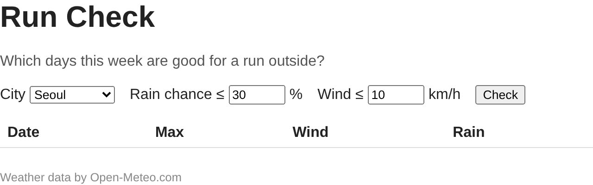
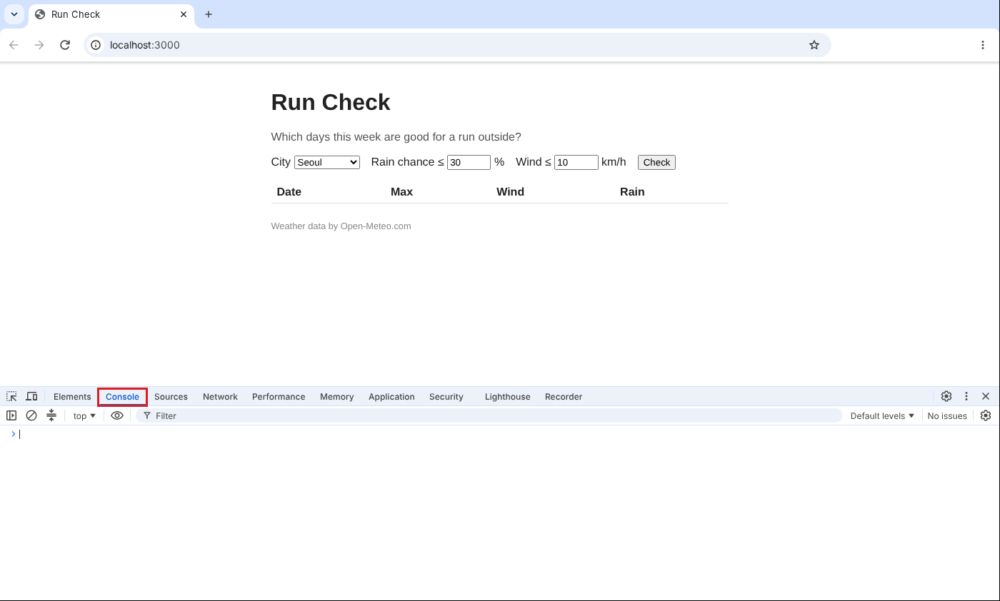

# P0. 내 저장소 만들고 띄우기

템플릿으로 내 저장소를 만들고 clone 하는 것은 지난 실습과 같습니다. 이번 주에 새로운 것은 페이지를 **로컬 서버로 띄우는 것** 하나입니다.

## 저장소 만들기 (브라우저)

1. 이 저장소 페이지 오른쪽 위 초록색 **Use this template** → **Create a new repository**.
2. **Owner** 가 내 계정인지 확인하고, **Repository name** 에 `oss-week09` 를 정확히 입력합니다.
3. **Public** 을 고르고 **Create repository**.

## clone 하기 (터미널)

4. 실습 폴더에서 clone 합니다. 주소는 내 저장소의 초록색 **Code** 버튼 → HTTPS 에서 복사합니다.
   ```
   git clone https://github.com/<내 ID>/oss-week09.git
   ```
   실습 폴더 안에 `oss-week09` 폴더가 생깁니다.

## VS Code 로 폴더 열기

5. VS Code 에서 **File → Open Folder** 로 방금 생긴 `oss-week09` 폴더를 엽니다. 파일 하나가 아니라 **폴더**를 엽니다.

   터미널에서 열고 싶으면 4번의 터미널에서 이어서 칩니다.
   ```
   cd oss-week09
   code .
   ```
   `code .` 는 "지금 폴더를 VS Code 로 연다" 는 뜻입니다. `code: command not found` 가 나오면 VS Code 에서 `Ctrl+Shift+P`(Mac 은 `Cmd+Shift+P`) → `Shell Command: Install 'code' command in PATH` 를 실행하고 터미널을 새로 연 뒤 다시 칩니다. Windows 는 VS Code 를 설치할 때 이미 등록되어 있는 경우가 많습니다. 안 되면 위의 Open Folder 로 엽니다.
6. **확인**: VS Code 왼쪽 파일 목록에 `api.js`, `check.js`, `index.html`, `logic.js`, `main.js`, `package.json`, `style.css` 와 폴더 `data`, `guide-images`, `problems` 가 보이면 됩니다. `main.js`, `api.js`, `logic.js` 는 주석만 있고 거의 비어 있습니다.

## 로컬 서버로 띄우기 (VS Code 터미널 → 브라우저)

7. VS Code 에서 **Terminal → New Terminal** 로 터미널을 엽니다. `oss-week09` 폴더에서 열렸는지 확인하고 실행합니다.
   ```
   npx serve .
   ```
   처음이면 `Need to install the following packages: serve ... Ok to proceed? (y)` 가 나옵니다. `y` 를 누르고 Enter.
8. 아래처럼 나오면 서버가 켜진 것입니다.
   ```
      ┌──────────────────────────────────────────┐
      │                                          │
      │   Serving!                               │
      │                                          │
      │   - Local:    http://localhost:3000      │
   ```
   `npx serve .` 는 "지금 폴더의 파일을 웹 서버로 내보낸다" 는 뜻입니다. 이 터미널은 서버가 쓰고 있으니 실습 내내 그대로 두고, git 명령은 **새 터미널**(터미널 패널 오른쪽 위 `+`)에서 칩니다.
9. 브라우저 주소창에 `http://localhost:3000` 을 입력합니다.
10. **확인**: 아래 화면이 보이면 됩니다. 표에는 머리줄만 있습니다.

   

11. **Check** 를 눌러 봅니다. 화면이 한 번 깜박이고 주소가 `localhost:3000/?` 로 바뀝니다. 아직 아무 코드가 없어서, 브라우저가 폼을 제출하면서 페이지를 새로 불러온 것입니다. P1 에서 이것부터 막습니다.
12. F12 를 눌러 개발자 도구를 열고 **Console** 탭을 고릅니다(아래 빨간 상자). 지금은 아무것도 없이 비어 있으면 됩니다. 실습 내내 열어 둡니다. 코드에 오류가 생기면 여기에 빨간 줄로 나옵니다.

    

    개발자 도구가 화면 오른쪽에 붙어 열릴 수도 있습니다. 위치는 상관없고 **Console** 탭만 고르면 됩니다.

커밋할 것은 없습니다.

---

[← 문제 목록](../README.md#문제) · [다음: P1](P1_submit.md) · [부록: 흔한 오류](../README.md#부록-흔한-오류)
