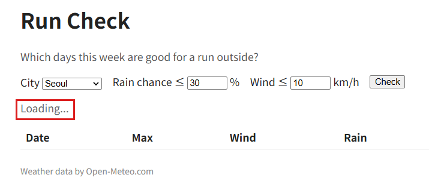
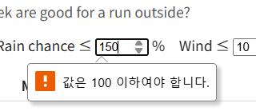

# P1. Check 버튼에 반응하기 — `p1: submit`

지금은 Check 를 누르면 페이지가 새로 고쳐지기만 합니다. 이번 문제에서는 Check 를 눌렀을 때 세 가지가 일어나게 합니다.

- (1) **새로 고침 막기**: 페이지가 다시 불러와지지 않고 그대로 있습니다.
- (2) **로딩 표시**: 누른 순간 폼 아래에 `Loading...` 이 뜹니다.
- (3) **고른 도시 확인**: 고른 도시의 정보를 Console 에 찍습니다.

아직 예보는 받지 않습니다(P2).

파일: `main.js`

## 만들 것

1. 먼저 VS Code 에서 `index.html` 을 열고, 아래 표의 id 가 실제로 어느 태그에 붙어 있는지 하나씩 찾아봅니다. 예를 들어 폼은 `<form id="run-form">`, 강수확률 기준 칸은 `<input id="rain-limit" ...>` 입니다. 일곱 개가 모두 보이면 다음으로 넘어갑니다.

   | 요소 | id | 변수 이름(예) |
   |---|---|---|
   | 폼 | `run-form` | `form` |
   | 도시 선택 | `city` | `citySelect` |
   | 강수확률 기준 칸 | `rain-limit` | `rainInput` |
   | 풍속 기준 칸 | `wind-limit` | `windInput` |
   | 상태 줄 | `status` | `statusEl` |
   | 요약 줄 | `summary` | `summaryEl` |
   | 표 본문 | `rows` | `rowsEl` |

2. `main.js` 에서 위 요소마다 변수를 하나씩 만들고, `index.html` 에서 그 id 로 요소를 찾아 넣습니다. 나중 문제에서 쓸 것까지 지금 일곱 개를 한 번에 만들어 둡니다. 변수 이름은 표의 예를 쓰면 뒤 문제의 힌트와 맞습니다.

   참고: 9주차 녹강 슬라이드 11장(Step 1. Find the Elements).

3. 폼이 **제출(submit)될 때** 실행되는 함수를 등록합니다. 그 함수는 이 순서로 합니다.
   - 페이지가 새로 고쳐지지 않게 막는다.
   - 도시 선택의 값(`seoul` 같은 키)으로 `CITIES` 에서 도시 객체를 꺼낸다.
   - 상태 줄에 `Loading...` 을 쓴다.
   - 꺼낸 도시 객체를 `console.log` 로 찍는다.

   참고: 9주차 녹강 슬라이드 12~15장(Events: addEventListener, Step 2. Why a Form?, Step 2. React to the Check Button, Step 2. Read the Inputs).

## 확인 (브라우저)

4. 저장하고 F5. Seoul 인 채로 **Check**.
   - 주소가 `localhost:3000/` 그대로이고 화면이 깜박이지 않습니다.
   - 폼 아래에 회색 `Loading...` 이 나옵니다. 받는 코드가 아직 없으니 계속 이 상태인 게 맞습니다.

     

   - Console 에 아래가 찍힙니다.
     ```
     {name: 'Seoul', lat: 37.566, lon: 126.9784}
     ```
5. 도시를 Gangneung 으로 바꾸고 Check. Console 에 `{name: 'Gangneung', ...}` 가 새로 찍히면 선택값을 제대로 읽은 것입니다.
6. 강수확률 칸에 `150` 을 넣고 Check.
   - 칸 아래에 `값은 100 이하여야 합니다.` 말풍선이 뜹니다. 영어 Chrome 에서는 `Value must be less than or equal to 100.` 입니다.
   - Console 에는 아무것도 찍히지 않습니다. `index.html` 의 `max="100"` 때문에 브라우저가 제출을 막았습니다.
   - 이 검사는 폼이 제출될 때 일어납니다. 이벤트를 버튼 click 에 걸었다면 검사 없이 함수가 바로 실행됩니다.
   - 확인했으면 `30` 으로 되돌립니다.

   

## 커밋 (새 터미널)

7. 커밋하고 push 합니다.
   ```
   git add main.js
   git commit -m "p1: submit"
   git push
   ```

---

[← 문제 목록](../README.md#문제) · [이전: P0](P0_setup.md) · [다음: P2](P2_fetch.md) · [부록: 흔한 오류](../README.md#부록-흔한-오류)
