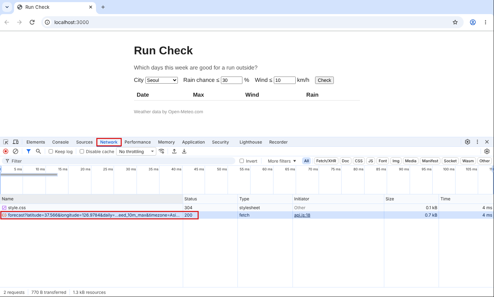
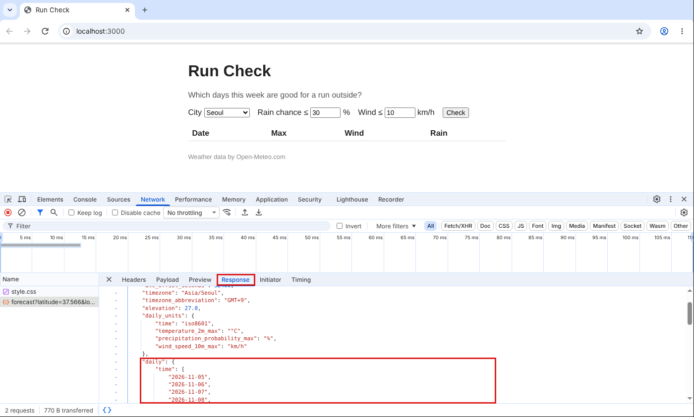

# P2. 예보 받아 오기 — `p2: fetch`

P1 에서 `Loading...` 까지 띄웠습니다. 이번에는 Open-Meteo 에서 고른 도시의 7일 예보를 실제로 받아 옵니다. 받아 오는 코드는 `api.js` 에, 그 함수를 부르고 결과에 따라 상태 줄을 바꾸는 코드는 `main.js` 에 씁니다. 표는 아직 그리지 않고 받은 데이터를 Console 에서 확인합니다.

파일: `api.js`, `main.js`

## 받을 항목 확인하기 (브라우저)

녹강의 umbrella 는 최저·최고기온과 강수확률을 받았습니다. Run Check 에 필요한 것은 아래 세 가지입니다.

| 필요한 값 | 필드 이름 | 문서의 체크박스 이름 |
|---|---|---|
| 그날 최고기온 | `temperature_2m_max` | Maximum Temperature (2 m) |
| 그날 최대 강수확률 | `precipitation_probability_max` | Precipitation Probability Max |
| 그날 최대 풍속(지상 10 m) | `wind_speed_10m_max` | Maximum Wind Speed (10 m) |

1. https://open-meteo.com/en/docs 를 **새 탭으로** 엽니다. 링크를 `Ctrl`(Mac 은 `Cmd`)을 누른 채 클릭하면 이 문제지를 그대로 두고 새 탭에서 열립니다. 아래로 내려가 **Daily Weather Variables** 에서 위 세 가지를 체크합니다.
   - 체크하면 `It is recommended to select a timezone for daily data. Per default the API will use GMT+0.` 라는 안내가 뜹니다. 하루 단위 값은 "하루가 몇 시에 시작하나" 에 따라 달라지는데, 시간대를 안 정하면 영국 시간(GMT+0) 기준 하루로 계산한다는 뜻입니다. 문서 페이지 위쪽 **Location and Time** 의 **Timezone** 목록에는 `Asia/Seoul` 이 없습니다. 서울과 시차가 같은(GMT+9) `Asia/Tokyo` 를 고르면 안내가 사라집니다. 이 페이지에서는 그냥 둬도 됩니다. 우리 코드는 요청에 `timezone=Asia/Seoul` 을 직접 넣습니다. 목록에 없을 뿐 서버는 이 값을 받습니다.
2. 더 아래 **API URL** 상자의 주소로 실제 응답을 받아 봅니다.
   - 주소에서 `daily=` 뒤를 봅니다. 체크한 세 가지가 쉼표로 이어져 있고, 위 표의 필드 이름과 같습니다.
   - 주소를 복사해 새 탭의 주소창에 붙여 넣고 Enter 를 누릅니다.
   - **확인**: 화면에 JSON 글자가 나옵니다. 그 안에 `"daily":{"time":[...` 가 있고, `time` 과 세 필드가 각각 날짜 수만큼의 값을 가진 배열이면 제대로 받은 것입니다. 지금 이 코드가 할 일을 브라우저 주소창으로 먼저 해 본 것입니다.
   - 문서의 위치는 기본값(Berlin)이라 숫자는 서울 날씨가 아닙니다. 풍속 단위는 기본값 그대로 km/h 입니다.

## 만들 것

3. `api.js` 에 `getForecast({ lat, lon })` 를 만들고 export 합니다.
   - 요청: `BASE` 주소에 위도, 경도, `daily`(위 세 필드), `timezone=Asia/Seoul`, `forecast_days=7`.
   - 응답이 성공(200 대)이 아니면 `HTTP 400` 같은 메시지로 throw.
   - 성공하면 응답 JSON 의 `daily` 만 돌려줌.

   참고: 9주차 녹강 슬라이드 16장(Step 3. Fetch the Forecast). **슬라이드와 다른 점**: 슬라이드는 fetch 를 `main.js` 의 submit 함수 안에 바로 썼습니다. 오늘은 fetch 를 `api.js` 의 `getForecast` 함수 안에 넣고 `export` 합니다. `main.js` 는 이 함수를 import 해서 부르기만 합니다(4번). 이렇게 나눈 모양은 41장(Three Files, One Job Each), 43장(main.js After the Split)에 있습니다.
4. `main.js` 에서 `getForecast` 를 import 하고, submit 함수에서 `Loading...` 을 쓴 다음 부릅니다.
   - 성공: 상태 줄을 비우고, 받은 `daily` 를 `console.log`.
   - 실패: 상태 줄에 `Could not load the forecast (<에러 메시지>).` 를 쓰고, 상태 줄에 class `error` 를 붙여 빨간색으로. (`#status.error` 는 `style.css` 에 이미 있습니다.)
   - 다시 Check 를 누르면 이전의 빨간색이 남아 있지 않아야 합니다.

   참고: 9주차 녹강 슬라이드 17장(Step 3. Show Waiting and Failure). submit 함수의 모양(`async`, `try`/`catch`, `error` class 붙이고 떼기, 실패 문구)은 슬라이드와 같습니다. **슬라이드와 다른 점** 두 가지:
   - `getForecast` 가 다른 파일(`api.js`)에 있으므로 `main.js` 맨 위에 import 줄이 있어야 합니다. 슬라이드는 같은 파일 안이라 import 가 없습니다. import 줄의 모양은 43장 첫 줄에 있습니다.
   - 성공했을 때 슬라이드는 상태 줄에 `Got 7 days for Seoul.` 을 쓰지만, 오늘은 상태 줄을 **비웁니다**. 받은 결과는 P3 부터 표로 보여 줍니다.
5. P1 에서 넣은 `console.log(city)` 는 지웁니다.

## 확인 (브라우저)

6. 저장하고 F5. Seoul 로 Check.
   - `Loading...` 이 잠깐 보였다가 사라집니다.
   - Console 에 아래 모양의 객체가 찍힙니다. 앞의 삼각형을 눌러 펼칩니다. 숫자는 예보라 날마다 다릅니다.
     ```
     {time: Array(7), temperature_2m_max: Array(7), precipitation_probability_max: Array(7), wind_speed_10m_max: Array(7)}
     ```
     키가 네 개(`time` + 내가 고른 세 개)이고 배열이 전부 7칸이면 됩니다.
7. 내 코드가 실제로 서버에 요청을 보냈는지 봅니다. F12 → **Network** 탭을 고르고 Check 를 다시 누릅니다.
   - 목록에 `forecast?latitude=...` 한 줄이 생기고 Status 가 `200` 입니다. 주소 끝을 보면 `api.js` 에서 넣은 위도·경도·필드가 그대로 붙어 있습니다.

     

   - 그 줄을 누르고 오른쪽의 **Response** 탭을 고릅니다. 서버가 보낸 JSON 전체가 보입니다. 내 함수가 돌려준 `daily` 는 그 안의 한 부분입니다. 2번에서 주소창으로 본 것과 같은 모양입니다.

     

8. 실패했을 때도 화면이 제대로 바뀌는지 봅니다.

   4번에서 만든 `catch` 쪽 코드는 받기가 **실패할 때만** 실행됩니다. 지금처럼 인터넷이 잘 되면 한 번도 실행되지 않으니, 맞게 썼는지 알 수 없습니다. 그런데 실제로 쓰는 사람에게는 와이파이가 끊기거나 서버가 멈추는 일이 생기고, 그때 화면이 `Loading...` 에서 멈춰 있으면 무슨 일인지 알 수 없습니다. 그래서 일부러 실패를 만들어 확인합니다. 개발자 도구에는 인터넷이 끊긴 것처럼 흉내 내는 설정이 있습니다.

   - Network 탭 위쪽의 `No throttling`(한국어 Chrome 은 `제한 없음`)을 눌러 `Offline`(`오프라인`)으로 바꿉니다.
   - Check 를 누릅니다. 상태 줄이 빨간색 `Could not load the forecast (Failed to fetch).` 가 되면 `catch` 쪽이 제대로 동작한 것입니다.
   - 다시 `No throttling` 으로 되돌리고 Check. 빨간 글자가 사라집니다. 성공했을 때 `error` class 를 떼는 코드도 제대로 동작한다는 뜻입니다.

   **`Offline` 을 꼭 되돌립니다.** 안 되돌리면 이후 문제에서 계속 실패합니다(부록 E5).

## 커밋 (터미널)

9. 커밋하고 push 합니다.
   ```
   git add api.js main.js
   git commit -m "p2: fetch"
   git push
   ```

---

[← 문제 목록](../README.md#문제) · [이전: P1](P1_submit.md) · [다음: P3](P3_rows.md) · [부록: 흔한 오류](../README.md#부록-흔한-오류)
