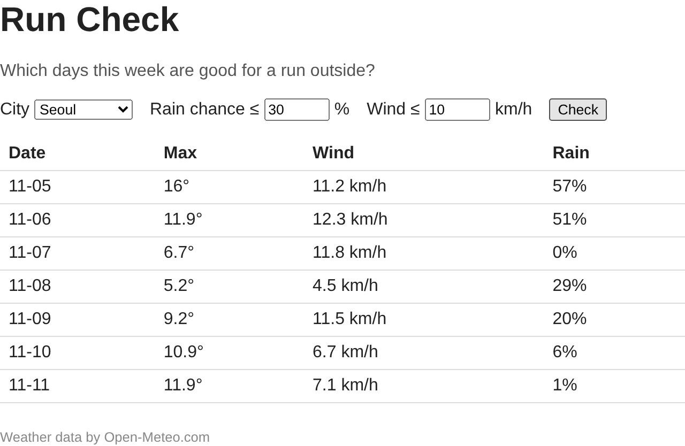

# P3. 하루에 한 줄씩 표 그리기 — `p3: rows`

P2 에서 받은 `daily` 는 **항목별** 배열입니다. `time` 배열 7칸, 최고기온 배열 7칸, …처럼 같은 날의 값이 배열 여러 개에 흩어져 있습니다. 표는 **하루에 한 줄**이 필요합니다. 그래서 두 단계로 나눕니다.

- `logic.js`: 항목별 배열을 하루 단위 객체의 배열로 바꾸는 함수. 화면을 모릅니다.
- `main.js`: 하루 객체 하나로 `<tr>` 한 줄을 만들고, 줄들을 표에 넣습니다.

그리고 화면에 보이는 값을 한곳(`state`)에 모아 두고 거기서 그리는 구조로 시작합니다. P4·P5 가 이 구조 위에서 돌아갑니다.

파일: `logic.js`, `main.js`

## 만들 것

1. `logic.js` 에 `toDays(daily)` 를 만들고 export 합니다. 받은 `daily` 를 아래 모양의 배열로 바꿉니다. 키 이름은 정확히 `date`, `max`, `wind`, `rain` 입니다.
   ```js
   [
     { date: "2026-11-05", max: 16, wind: 11.2, rain: 57 },
     { date: "2026-11-06", max: 11.9, wind: 12.3, rain: 51 },
     // ... 7개
   ]
   ```

   참고: 9주차 녹강 슬라이드 42장(logic.js)의 `toDays`, 항목별 배열에서 같은 번호로 하루를 꺼내는 그림은 18장(Step 4. The Big Picture). **슬라이드와 다른 점**: 슬라이드는 `min`(최저기온)을 넣지만 오늘은 `min` 이 없고 `wind` 가 있습니다. 꺼내는 필드 이름도 P2 에서 받은 세 가지입니다.

2. `main.js` 에 화면 상태를 담을 객체 `state` 를 둡니다. 지금은 `city`(고른 도시 객체, 처음엔 `null`)와 `days`(하루 객체 배열, 처음엔 빈 배열) 두 가지입니다.

   참고: 24장(Step 5. state and dayRow()). **슬라이드와 다른 점**: 슬라이드의 `state` 에는 `threshold` 도 있지만, 오늘은 `city`, `days` 둘만 둡니다. 기준은 P4 에서 넣습니다.

3. `main.js` 에 `dayRow(day)` 를 만듭니다. 하루 객체 하나를 받아 `<tr>` 하나를 돌려줍니다. 칸은 네 개, 이 순서와 모양으로.

   | Date | Max | Wind | Rain |
   |---|---|---|---|
   | `11-05` (연도 빼고) | `16°` | `11.2 km/h` | `57%` |

   칸의 글자는 `textContent` 로 넣습니다. `innerHTML` 을 쓰지 않습니다.

   참고: 24장의 `dayRow`, 21장(User Data Goes in textContent, Not innerHTML). **슬라이드와 다른 점**: 칸이 Date, Max, Wind, Rain 입니다(슬라이드는 Date, Min, Max, Rain). 줄에 색을 칠하는 `if` 줄은 아직 쓰지 않습니다(P4).

4. `main.js` 에 `render()` 를 만듭니다. `state.days` 의 하루마다 `dayRow` 로 줄을 만들어 표 본문(`#rows`)에 넣습니다. **이전에 있던 줄은 없어져야 합니다.**

   참고: 20장(Step 4. Put the Rows on the Page), 25장(Step 5. render()). 두 장을 이렇게 이어서 봅니다.
   - **20장**: 줄들을 표에 넣는 방법입니다. `rowsEl.replaceChildren(...rows)` 는 표 본문에 있던 줄을 모두 빼고 새 줄들로 한 번에 바꿉니다. `append` 로 붙이기만 하면 Check 를 누를 때마다 줄이 쌓입니다. 오른쪽 Recall 박스는 `...` 이 배열을 풀어서 하나씩 넘겨 준다는 설명입니다.
   - **25장**: 그 줄들을 어디서 만드는지입니다. `render()` 의 마지막 줄은 `state.days` 의 하루마다 `dayRow` 를 불러 `<tr>` 배열을 만들고(`.map(dayRow)`), 그 배열을 20장의 `replaceChildren(...)` 에 넘깁니다. 아래 박스가 이 한 줄을 두 줄로 풀어 쓴 것입니다.
   - **조합**: 25장 `render()` 에서 **표를 그리는 마지막 줄**만 가져오면 됩니다. 앞의 두 문장(좋은 날을 세고 요약 줄을 쓰는 부분)은 P4 에서 넣습니다. `dayRow` 는 3번에서 만든 것을 그대로 씁니다.

5. submit 함수를 고쳐 받은 예보를 `state` 에 넣고 그리게 합니다. 바뀌는 줄은 아래와 같습니다. 그대로 넣으면 됩니다.
   ```js
   import { toDays } from "./logic.js"; // main.js 맨 위, getForecast import 아래에 추가

   // submit 함수 안
     try {
       // ... P2 에서 daily 를 받는 줄 그대로 ...
       state.city = city;
       state.days = toDays(daily);
       statusEl.textContent = "";
     } catch (err) {
       // ... P2 그대로 ...
     }
     render(); // try/catch 밖, 함수의 맨 끝
   ```
   - P2 의 `console.log(daily)` 는 지웁니다.
   - 실패하면 `state` 를 건드리지 않습니다. 그래서 실패해도 이전에 받은 도시의 표가 그대로 남고, 그 위에 빨간 오류가 뜹니다.
   - `render()` 는 `try`/`catch` 밖에 있어서 성공이든 실패든 마지막에 한 번 불립니다.
   - `state` 는 `querySelector` 줄들 **아래**에 둡니다. P4 에서 `state` 를 만들 때 입력칸을 읽게 되는데, 위에 두면 아직 찾지 않은 요소를 쓰게 됩니다(부록 E2b).

   참고: 26장(Step 5. Two Events, One render())의 submit 함수, 43장 마지막 줄. 슬라이드는 하루 객체로 바꾸는 코드를 submit 안에 직접 썼고, 오늘은 1번의 `toDays` 를 부릅니다.

## 확인 (브라우저)

6. 저장하고 F5. Seoul 로 Check. 아래처럼 7줄이 나오면 됩니다. 숫자는 예보라 다릅니다. `undefined` 가 보이면 부록 E7.

   

7. Check 를 서너 번 연달아 누릅니다. 줄이 계속 **7줄**이어야 합니다. 14줄, 21줄로 늘면 4번의 "이전 줄은 없어져야" 를 안 한 것입니다(부록 E8).
8. 도시를 Gangneung 으로 바꾸고 Check. 표의 7줄이 강릉의 7일 예보(최고기온, 풍속, 강수확률)로 바뀝니다. 서울 때와 숫자가 달라졌으면 고른 도시대로 받아 온 것입니다.

## 커밋 (터미널)

9. 커밋하고 push 합니다.
   ```
   git add logic.js main.js
   git commit -m "p3: rows"
   git push
   ```

---

[← 문제 목록](../README.md#문제) · [이전: P2](P2_fetch.md) · [다음: P4](P4_rule.md) · [부록: 흔한 오류](../README.md#부록-흔한-오류)
