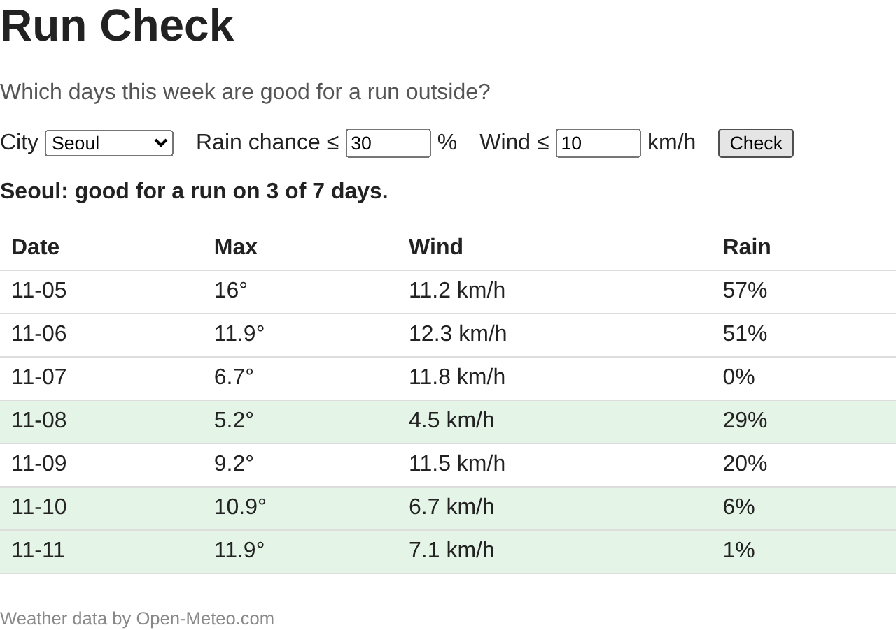

# P4. 달리기 좋은 날 칠하기 — `p4: rule`

이제 규칙을 넣습니다. 규칙은 화면과 상관없는 판단이므로 `logic.js` 에 순수 함수로 두고, `main.js` 는 그 결과로 줄에 색을 칠하고 요약 문장을 씁니다.

**규칙**: 강수확률이 기준 **이하**이고, 풍속도 기준 **이하**이면 달리기 좋은 날이다.

예를 들어 기준을 강수확률 30 %, 풍속 10 km/h 로 두면(입력칸의 처음 값) 아래처럼 판정합니다. 기준은 사용자가 입력칸에서 바꿀 수 있고, 규칙은 어떤 기준이 와도 같은 방식으로 판정해야 합니다.

| 강수확률 | 풍속 | 좋은 날? | |
|---|---|---|---|
| 20 | 6.7 | 예 | 둘 다 기준 아래 |
| 30 | 10 | 예 | 기준과 **같으면 통과** |
| 31 | 5 | 아니오 | 강수만 넘음 |
| 0 | 11.8 | 아니오 | 풍속만 넘음 |
| 57 | 11.2 | 아니오 | 둘 다 넘음 |

파일: `logic.js`, `main.js`

## 만들 것

1. `logic.js` 에 `isGoodDay(day, limits)` 를 만들고 export 합니다.
   - `day` 는 P3 의 하루 객체, `limits` 는 `{ rain: 30, wind: 10 }` 모양입니다.
   - 위 규칙대로 `true` / `false` 를 돌려줍니다.

   참고: 39장(Pure Functions), 42장(logic.js)의 `needsUmbrella`. 하는 일의 모양은 같고, 아래 세 가지가 다릅니다.
   - **함수 이름**: 슬라이드는 "우산이 필요한 날" 을 찾으므로 `needsUmbrella` 입니다. 오늘은 "달리기 좋은 날" 을 찾으므로 이름도 그 뜻에 맞게 `isGoodDay` 로 짓습니다. 이름만 보고 무엇을 판단하는지 알 수 있어야 합니다. `true` / `false` 를 돌려주는 함수라서 `is...` 로 시작합니다.
   - **조건**: 슬라이드는 조건 하나(`day.rain >= threshold`, 기준 **이상**이면 우산)입니다. 오늘은 강수와 풍속 두 조건을 **그리고**로 묶고, 둘 다 기준 **이하**여야 통과입니다.
   - **기준을 받는 방법**: 슬라이드는 기준을 숫자 하나(`threshold`)로 받습니다. 오늘은 기준이 둘이라 객체 하나(`limits`)에 담아 받습니다.

2. `logic.js` 에 `summarize(days, limits)` 를 만들고 export 합니다. 좋은 날의 수와 전체 날 수로 아래 문장을 돌려줍니다.
   ```
   good for a run on 3 of 7 days
   ```

   좋은 날인지 따지는 코드를 여기서 다시 쓰지 않습니다. **1번에서 만든 `isGoodDay` 를 불러서** 좋은 날만 골라 셉니다. 그래야 규칙이 `isGoodDay` 한 곳에만 있고, 표의 초록 줄 수와 요약 문장의 숫자가 항상 같습니다.

   참고: 42장의 `summarize`. 슬라이드의 `summarize` 도 직접 비교하지 않고 `needsUmbrella` 를 불러서 셉니다. **슬라이드와 다른 점**: 부르는 함수가 `isGoodDay` 이고, 돌려주는 문장이 다르고, 기준을 `limits` 로 받습니다.

3. `main.js` 의 `state` 에 기준 `limits` 를 추가합니다. P3 의 `state` 를 아래처럼 바꿉니다.
   ```js
   const state = {
     city: null,
     days: [],
     limits: { rain: Number(rainInput.value), wind: Number(windInput.value) },
   };
   ```
   - 처음 값은 두 기준 칸에 들어 있는 값(30, 10)입니다.
   - 입력칸의 `.value` 는 숫자처럼 보여도 **문자열**입니다. 그래서 `Number(...)` 로 숫자로 바꿔서 넣습니다.
   - Check 를 누를 때도 사용자가 기준을 바꿨을 수 있습니다. submit 함수 안에서 같은 방식으로 두 칸을 다시 읽어 `state.limits` 에 넣습니다.

   참고: 15장(Step 2. Read the Inputs), 24장의 `state` 첫 줄. **슬라이드와 다른 점**: 슬라이드는 기준이 하나라 `threshold` 숫자 하나를 두지만, 오늘은 기준이 둘이라 `limits` 객체 하나에 담습니다.

4. `dayRow` 에서 그날이 좋은 날이면 `<tr>` 에 class `good` 을 붙입니다(`style.css` 에 초록 배경이 이미 있습니다).
   - 좋은 날인지는 여기서 직접 비교하지 않고 **1번의 `isGoodDay` 를 불러** 묻습니다.
   - 넘겨줄 기준은 입력칸에서 바로 읽지 않고 **`state.limits`** 에서 꺼냅니다. 화면은 `state` 만 보고 그린다는 P3 의 약속 그대로입니다.
   - 넣을 자리는 칸(`<td>`)을 다 붙인 뒤, `return tr` 바로 앞입니다.
   - 요소에 class 를 붙이는 방법은 P2 에서 상태 줄에 `error` 를 붙일 때와 같습니다.

   참고: 43장(main.js After the Split)의 `dayRow` 줄. **슬라이드와 다른 점**: 부르는 함수가 `isGoodDay`, 넘기는 기준이 `state.limits`, class 이름이 `wet` 이 아니라 `good` 입니다.

5. `render` 에서 요약 줄(`#summary`)에 문장을 씁니다.

   | 상황 | 요약 줄 |
   |---|---|
   | 아직 Check 를 안 눌렀음(`state.city` 가 `null`) | 빈 문자열 `""` |
   | 받은 뒤 | `Seoul: good for a run on 3 of 7 days.` |

   - 받은 뒤의 문장은 세 조각입니다. 도시 이름(`state.city.name`) + `: ` + **2번의 `summarize` 결과** + 마침표.
   - `summarize` 에는 `state.days` 와 `state.limits` 를 넘깁니다.
   - "도시가 있으면 이 문장, 없으면 빈 문자열" 은 `if`/`else` 로 써도 되고, 25장 `render()` 의 `summaryEl.textContent = ...` 줄처럼 `조건 ? 값1 : 값2` 한 줄로 써도 됩니다.
   - 요약 줄을 `render` 안에서 쓰기 때문에, P5 에서 기준만 바꾸고 `render()` 를 다시 부르면 표와 요약이 같이 바뀝니다.

   참고: 25장(Step 5. render())의 `summaryEl` 줄, 43장의 `render` 줄. **슬라이드와 다른 점**: 문장과 기준(`limits`)만 다릅니다.

## 확인 (브라우저)

6. 저장하고 F5. Seoul 로 Check. 아래처럼 일부 줄이 초록이고 요약 문장이 나오면 됩니다.

   

7. 숫자는 예보라 그림과 다릅니다. 대신 이 세 가지를 직접 맞춰 봅니다.
   - 초록 줄의 수 = 요약 문장의 첫 숫자.
   - 초록 줄은 모두 Rain ≤ 30 이고 Wind ≤ 10 이다.
   - 초록이 아닌 줄은 Rain > 30 이거나 Wind > 10 이다(둘 중 하나 이상).
8. 풍속 칸을 `12` 로 바꾸고 **Check 를 다시 눌러** 초록 줄이 늘어나는지 봅니다. 확인했으면 `10` 으로 되돌립니다. Check 를 다시 눌러야만 바뀌는 게 불편하면 정상입니다. P5 에서 고칩니다.

## 커밋 (터미널)

9. 커밋하고 push 합니다.
   ```
   git add logic.js main.js
   git commit -m "p4: rule"
   git push
   ```

---

[← 문제 목록](../README.md#문제) · [이전: P3](P3_rows.md) · [다음: P5](P5_live.md) · [부록: 흔한 오류](../README.md#부록-흔한-오류)
