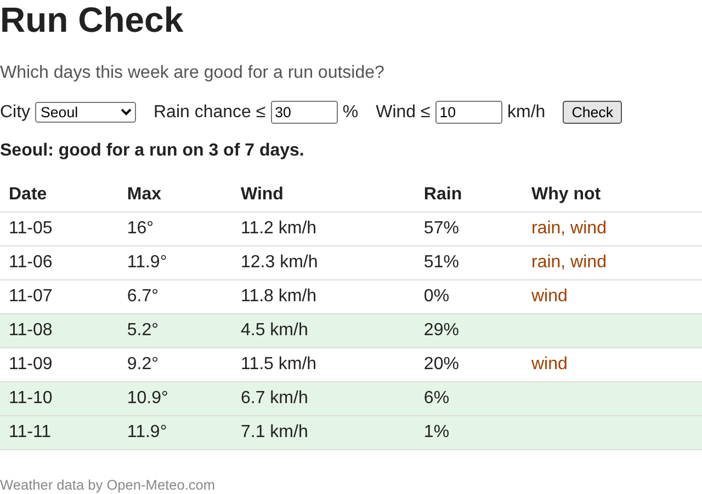

# P7. 왜 탈락했는지 보여 주기 — `p7: reasons`

초록이 아닌 날을 보면 "비 때문인가, 바람 때문인가?" 를 Rain·Wind 칸과 기준을 번갈아 보며 직접 따져야 합니다. 앱이 판단했으면 이유도 앱이 보여 주는 게 낫습니다. 표에 **Why not** 칸을 추가합니다.

이번 문제에는 조건이 하나 더 있습니다. **규칙(비교식)은 `logic.js` 안에 한 곳에만** 있어야 합니다.

파일: `logic.js`, `index.html`, `main.js`, `check.js`

## 만들 것

1. `logic.js` 에 `reasons(day, limits)` 를 만들고 export 합니다. 기준을 넘은 항목의 이름을 배열로 돌려줍니다. 순서는 항상 `rain` 이 먼저입니다.

   | 강수확률 | 풍속 | `reasons` 결과 (예: 기준 강수 30 %, 풍속 10 km/h) |
   |---|---|---|
   | 20 | 6.7 | `[]` |
   | 30 | 10 | `[]` |
   | 31 | 5 | `["rain"]` |
   | 0 | 11.8 | `["wind"]` |
   | 57 | 11.2 | `["rain", "wind"]` |

   참고: 녹강에는 같은 함수가 없습니다. "넘었다" 는 P4 규칙(이하면 통과)의 반대이므로 비교 기호가 P4 와 다릅니다.

2. 이제 `logic.js` 에는 "기준을 넘었나" 를 따지는 코드가 `isGoodDay` 와 `reasons` 두 군데에 있습니다. 나중에 기준을 하나 더 넣을 때(예: 기온) 한쪽만 고치면 표의 색과 Why not 칸이 서로 다른 말을 하게 됩니다. **`isGoodDay` 를 `reasons` 를 써서 다시 씁니다.** 다 하고 나면 `logic.js` 에서 `limits.rain`, `limits.wind` 는 `reasons` 안에만 나옵니다.

   참고: 38장(Where Is the Umbrella Rule?). 슬라이드에서는 같은 규칙이 `dayRow` 와 `render` 두 군데에 있어서, 한쪽만 고치면 표와 요약이 서로 다른 말을 했습니다. 오늘은 같은 일이 `logic.js` 안에서 생긴 것입니다. 슬라이드는 `summarize` 가 `needsUmbrella` 를 부르게 해서 규칙을 한 곳에 모았습니다(42장). 같은 방법으로 `isGoodDay` 가 `reasons` 를 부르게 합니다.

3. `index.html` 의 표 머리줄 맨 끝에 `<th>Why not</th>` 을 추가합니다.
4. `main.js` 의 `dayRow` 에 다섯째 칸을 추가합니다. `reasons` 결과를 `rain, wind` 처럼 쉼표와 공백으로 이어 씁니다. 빈 배열이면 빈 칸입니다.

   참고: 24장의 `dayRow` 칸 목록. 배열 `["rain", "wind"]` 를 문자열 `rain, wind` 로 잇는 것은 배열의 메서드 하나로 됩니다.

5. `check.js` 에 `reasons` 를 확인하는 줄을 세 개 이상 추가합니다. 예상 주석을 먼저 적는 것은 P6 과 같습니다. 결과가 `[]`, 한 개, 두 개인 경우가 다 들어가게 합니다.

## 확인 (브라우저, 터미널)

6. 저장하고 F5. Seoul 로 Check. 아래처럼 Why not 칸이 나오면 됩니다.

   

7. 표에서 다음을 봅니다.
   - 초록 줄은 Why not 칸이 **비어 있습니다.**
   - 초록이 아닌 줄은 Why not 칸이 **반드시 채워져 있습니다.**
   - 기준 칸을 바꾸면 색과 함께 Why not 칸도 바로 바뀝니다(P5 에서 만든 것이 그대로 동작).
8. 터미널에서 `node check.js`. P6 에서 적은 줄은 그대로 같은 결과이고, 새로 넣은 `reasons` 줄도 예상과 같아야 합니다. `isGoodDay` 를 다시 쓴 뒤에도 P6 의 결과가 그대로라는 것이 2번이 잘 됐다는 확인입니다.

## 커밋 (터미널)

9. 커밋하고 push 합니다.
   ```
   git add logic.js index.html main.js check.js
   git commit -m "p7: reasons"
   git push
   ```

---

[← 문제 목록](../README.md#문제) · [이전: P6](P6_check.md) · [부록: 흔한 오류](../README.md#부록-흔한-오류)
